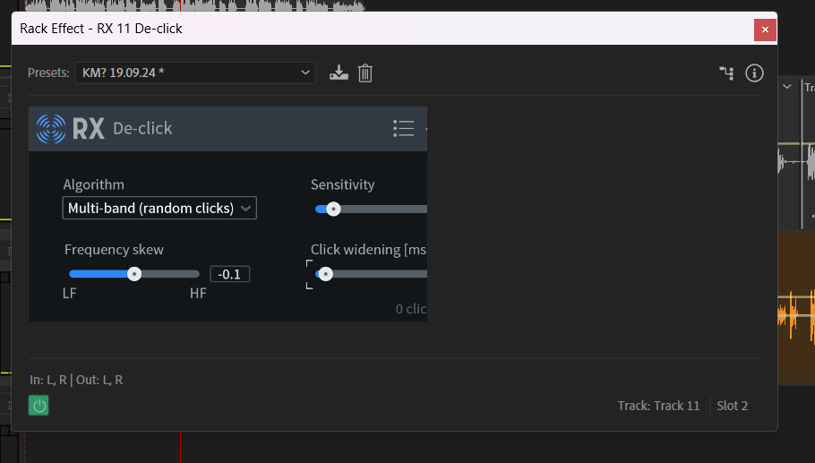
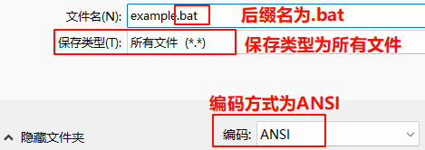

## 问题说明

今天碰到一个有趣的问题，在一台屏幕分辨率非常高的电脑上，使用 Adobe Audition 软件的过程中，启动一些插件时，会碰到 DPI 高分辨率不兼容的问题：如果以默认方式启动程序，打开插件会显示不完全：



我还尝试过更改软件的 DPI 兼容性：

在 Adobe Audition 的 exe 程序，或者任意快捷方式上，右击，打开属性，然后选择兼容性选项卡，点击“更改高 DPI 设置”按钮，勾选“忽略系统中的缩放比例设置，使用以下设置尝试修复此程序的缩放比例问题”，在“执行以下操作时使用为我的主显示器设置的 DPI ”选项中，选择“打开此程序”，勾选“高 DPI 缩放替代”选项，缩放执行选项选择“系统(增强)”。

重新打开程序后，插件界面可以正常显示，但是整个程序界面会变得非常模糊，难以使用。

如果直接设置软件的分辨率为 100% 缩放，则所有按钮文字图标都会变得非常小，难以使用。

这个问题本质上是由于插件开发厂家没有进行高DPI适配造成的。我们也没有办法通过设置两个不同的快捷方式，一个是正常启动，一个是设置了兼容性方案的启动。因为对于某个应用的兼容性相关设置，是直接改的注册表，并不是更改 exe 或者快捷方式文件的属性（神奇的 Windows 脑回路）。

## 解决方案

直接改原程序是不现实的，不过，我们可以通过制作一个 bat 脚本，将 exe 文件或者快捷方式作为参数，然后程序执行时，临时设置注册表为 DPI 兼容性方案启动，用完相关插件后，退出程序， bat 自动设置注册表相关内容为之前的内容，下次再运行对应的程序就会按照默认方式进行了。说白了就是临时更改 DPI 兼容性方案的一种启动方法。

源程序如下：

```bat
@echo off
setlocal enabledelayedexpansion

:: 检查参数是否存在
if "%~1"=="" (
    echo 错误：请拖放 .exe 或 .lnk 文件到本脚本
    pause
    exit /b 1
)

:: 获取文件扩展名
set "file_ext=%~x1"

:: 根据文件类型处理目标路径
if /i "!file_ext!"==".lnk" (
    echo 正在解析快捷方式...
    for /f "usebackq delims=" %%a in (`powershell -command "$sh=New-Object -ComObject WScript.Shell; ( $sh.CreateShortcut('%~1') ).TargetPath"`) do (
        set "target_exe=%%a"
    )
) else if /i "!file_ext!"==".exe" (
    set "target_exe=%~1"
) else (
    echo 错误：不支持的文件类型 - 仅支持 .exe 或 .lnk
    pause
    exit /b 1
)

echo 目标程序: !target_exe!

:: 注册表路径
set "reg_path=HKCU\Software\Microsoft\Windows NT\CurrentVersion\AppCompatFlags\Layers"

:: 备份原始注册表值
set "original_value="
for /f "tokens=2*" %%a in ('reg query "%reg_path%" /v "!target_exe!" 2^>nul') do (
    set "original_value=%%b"
)

:: 设置临时DPI缩放（系统增强）
reg add "%reg_path%" /v "!target_exe!" /d "GDIDPISCALING" /f >nul

:: 运行程序并等待退出
echo 正在以系统(增强)DPI缩放启动程序...
start "" /wait "!target_exe!"

:: 恢复原始注册表设置
if defined original_value (
    reg add "%reg_path%" /v "!target_exe!" /d "!original_value!" /f >nul
    echo 已恢复原始DPI设置
) else (
    reg delete "%reg_path%" /v "!target_exe!" /f >nul 2>&1
    echo 已删除临时DPI设置
)

endlocal
echo 程序已退出
```

将这个程序用记事本保存成一个后缀名为 `.bat` 的文件，注意在保存文件时选择 `ANSI` 编码方式、文件名后缀名为 `.bat`，保存类型为`所有文件 （*.*）`:



然后将任意的 Adobe Audition 的快捷方式或者 exe 源程序拖动到这个程序上面，就可以以 DPI 兼容性方式启动了，此时，插件的界面可以完全显示，但是界面是模糊的。等用完了，关闭程序，等待命令行界面自动退出后，重新正常打开 Adobe Audition 使用即可。

## 程序说明

这个程序需要说明的地方有两点，其一是利用 `reg` 指令进行注册表操作，其中，`GDIDPISCALING` 即为系统增强模式的缩放行为。其二是一个小技巧，如何根据快捷方式 `.lnk` 文件找到目标文件。

我们直接执行一个 `PowerShell` 命令，意思是通过 `WShell` 创建一个快捷方式，新创建的快捷方式可以读取其目标地址的属性。

那为什么不直接写一个 `PowerShell` 脚本呢？原因是 `.ps1` 文件无法直接执行，没有 `bat` 文件方便。
